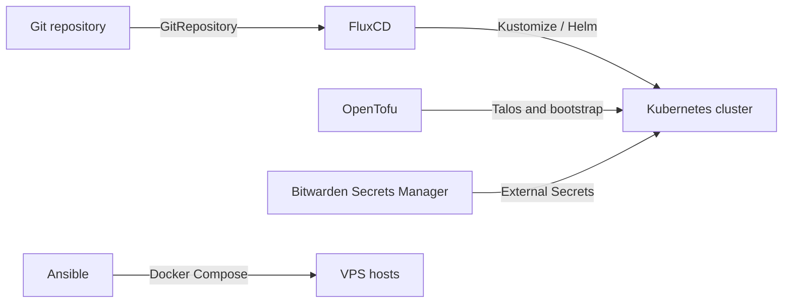
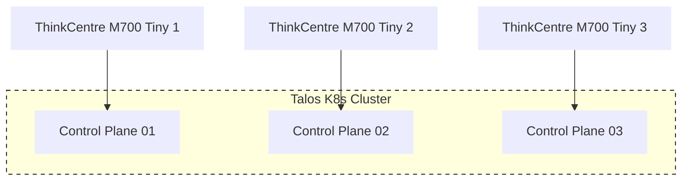
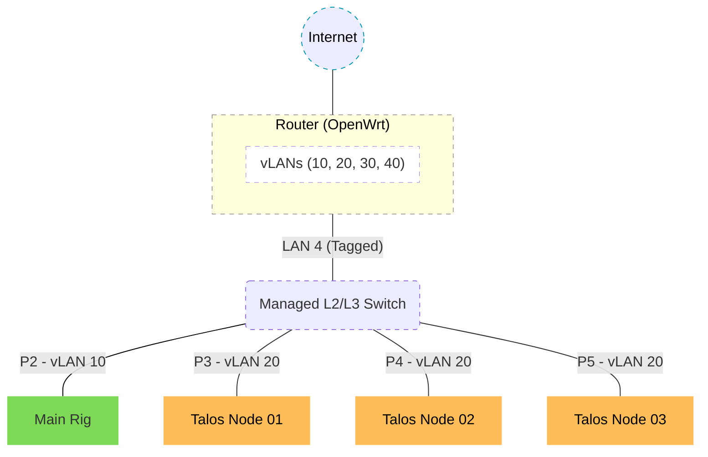

# HomeLab

My personal homelab for learning and testing infrastructure, networking, Kubernetes, GitOps, observability, and self-hosted services.

## Overview

This repository is a monorepo for the complete homelab stack:

- Bare-metal Kubernetes on three Talos nodes
- Declarative cluster provisioning with OpenTofu
- FluxCD reconciliation for Kubernetes resources
- Cilium networking and load balancing
- Bitwarden Secrets Manager through External Secrets
- Prometheus and Grafana for observability
- Docker Compose workloads on VPS hosts
- Ansible for repeatable VPS setup and application deployment

| Layer | Technology | Purpose |
| --- | --- | --- |
| Provisioning | [OpenTofu](https://opentofu.org/), [Talos Linux](https://docs.siderolabs.com) | Bare-metal cluster provisioning and node configuration |
| Network | VLANs, OpenWrt, TP-Link Omada switch | Segmentation and routing |
| Kubernetes networking | [Cilium](https://cilium.io/) | CNI, load-balancer IPAM, L2 announcements, and Hubble |
| GitOps | [FluxCD](https://fluxcd.io/) | Reconciles cluster state from this repository |
| Platform services | Cert-Manager, External Secrets, Kubeseal, OpenEBS, Reloader, Pangolin Newt | Certificates, secrets, storage, and supporting services |
| Monitoring | [Prometheus](https://github.com/prometheus-community/helm-charts/tree/main/charts/kube-prometheus-stack), [Grafana Operator](https://github.com/grafana/grafana-operator) | Metrics collection, dashboards, and alerting |
| Cluster workloads | LittleLink | Kubernetes-hosted application workload |
| VPS workloads | Glance Agent, Pocket ID, Uptime Kuma | Docker Compose services deployed outside the cluster |
| Secrets | [Bitwarden Secrets Manager](https://bitwarden.com/) and [External Secrets](https://external-secrets.io/) | Generates Kubernetes secrets from centrally managed values |

## Repository Layout

| Path | Contents |
| --- | --- |
| [infrastructure/](infrastructure/) | OpenTofu configuration for Talos, Flux bootstrap, and supporting resources |
| [talos/](talos/) | Talos machine configuration and patches |
| [kubernetes/](kubernetes/) | Flux entry points, platform services, and application manifests |
| [ansible/](ansible/) | VPS host configuration and Docker Compose deployment |
| [vps/](vps/) | Docker Compose stacks and Bitwarden-backed secret definitions |

## Management Flow

Changes to Kubernetes manifests are reconciled by Flux. Cluster resources should therefore be defined under [kubernetes/](kubernetes/) and committed to Git rather than edited directly on the cluster.

## Cluster Design

This homelab runs Talos Linux directly on three physical Lenovo ThinkCentre M700 Tiny nodes. The nodes form a highly available Kubernetes control plane and are managed as bare-metal infrastructure with OpenTofu.

### 🖧 Network Architecture

While this may be considered overkill for a home environment, the design is intentional -- prioritizing hands-on learning and real-world networking practices. The network is built around the following principles:
- VLAN-based isolation
- Least-privilege inter-VLAN access
- Centralized routing and firewalling
- No direct WAN exposure of internal services

#### Topology Diagram

#### VLAN Overview

| vLAN | Purpose           | Description                   |
| ---- | ----------------- | ----------------------------- |
| 10 | User / Management | Workstations and administration |
| 20 | Homelab | Talos bare-metal Kubernetes |
| 30 | Media | Media services and devices |
| 40 | Guest | Isolated guest access |

### ⚙ Hardware Inventory

This section documents my current homelab hardware inventory, which may change as the lab evolves.

#### Network
| Device | Model                                       |   OS      |    Role                | Notes                   |
| ------ | ------------------------------------------- | --------- | ---------------------- | ----------------------- |
| Router | [D-Link M30](https://amzn.in/d/injpNRq)     | OpenWRT   | Edge router & firewall | VLAN routing, DHCP, NAT |
| Switch | [TP-Link SG3210](https://amzn.in/d/caTUAhH) | Omada/OEM | Network segmentation   | VLANs, trunk ports      |

#### Compute
| Node          | Platform                         | OS         | CPU           | Memory    | Storage   | Role                      |
| ------------- | -------------------------------- | ---------- | ------------- | --------- | --------- | ------------------------- |
| Talos Node 01 | Lenovo ThinkCentre M700 Tiny    | Talos Linux | Intel i5-6500T | 8 GB DDR4 | 256 GB SSD | Kubernetes control plane |
| Talos Node 02 | Lenovo ThinkCentre M700 Tiny    | Talos Linux | Intel i5-6500T | 8 GB DDR4 | 256 GB SSD | Kubernetes control plane |
| Talos Node 03 | Lenovo ThinkCentre M700 Tiny    | Talos Linux | Intel i5-6500T | 8 GB DDR4 | 256 GB SSD | Kubernetes control plane |

The custom-built Main Rig is used for personal computing and administration; it is not part of the Kubernetes cluster.

---

#### References

Some good references that I used for exploring and selecting the stuffs mentioned above:
- [Talos Linux documentation](https://docs.siderolabs.com/talos)
- [Homelab networking 101](https://www.virtualizationhowto.com/2025/10/home-lab-networking-101-vlans-subnets-and-segmentation-for-beginners/)
- [TP-Link Omada Switches](https://www.tp-link.com/in/support/faq/4094/)
